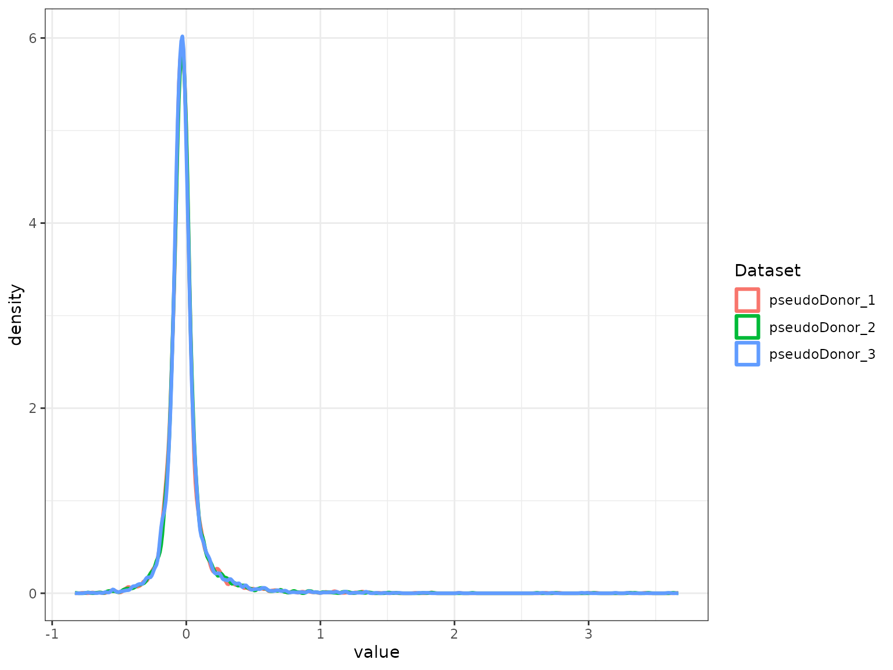
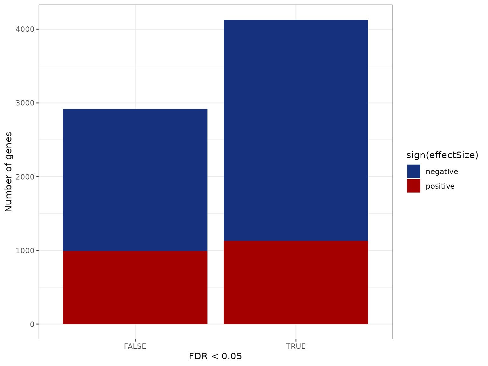
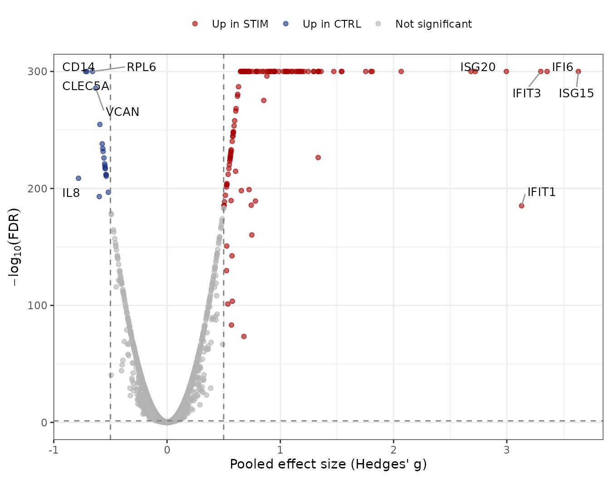

# Example 1: Differential expression with runscMI()

## Overview

This example runs a complete scMetaIntegrator (scMI) analysis on a
public dataset and returns a table of differentially expressed genes
(DEGs). It uses
[`runscMI()`](https://khatri-lab.github.io/scMetaIntegrator/reference/runscMI.md),
the simplest entry point.
[`runscMI()`](https://khatri-lab.github.io/scMetaIntegrator/reference/runscMI.md)
returns one row per gene with the pooled effect size and its
significance. Example 2 shows how to get the full MetaIntegrator object
for forest plots and gene scores.

scMI is designed for paired designs, such as where the same donor is
measured under two conditions. Each donor is analyzed as its own study,
and the results are pooled across donors with random-effects
meta-analysis. This keeps the donor as the unit of replication and
avoids treating cells from one donor as independent replicates.

The workflow has four steps:

| Step | Function | Purpose |
|:---|:---|:---|
| 1 | [`NormalizeData()`](https://satijalab.org/seurat/reference/NormalizeData.html) and metadata setup | Prepare a log-normalized Seurat object with a sample, a pairing and a condition column |
| 2 | [`confirmPairs()`](https://khatri-lab.github.io/scMetaIntegrator/reference/confirmPairs.md) | Check that every pair has exactly two samples |
| 3 | [`thresholdGenesAcrossPairs()`](https://khatri-lab.github.io/scMetaIntegrator/reference/thresholdGenesAcrossPairs.md) | Keep genes expressed in at least 1% of cells in every pair |
| 4 | [`runscMI()`](https://khatri-lab.github.io/scMetaIntegrator/reference/runscMI.md) | Pool per-pair effect sizes into one result per gene |

## Setup

The example data come from the `ifnb.SeuratData` package. Install it
once if you do not have it.

``` r

install.packages("https://seurat.nygenome.org/src/contrib/ifnb.SeuratData_3.0.0.tar.gz",
                 repos = NULL, type = "source")
```

Loading MetaIntegrator is required to run scMetaIntegrator. ggplot2 and
ggrepel are only used for the plots at the end.

``` r

library(scMetaIntegrator)
library(Seurat)
library(ifnb.SeuratData)
library(MetaIntegrator)
library(multtest)

## packages for the plots in step 5
library(ggplot2)
library(ggrepel)
theme_set(theme_bw())
```

## Step 1: Load and preprocess the data

The `ifnb` dataset contains PBMCs that were either stimulated with
interferon beta (`STIM`) or left as controls (`CTRL`). The dataset does
not record donors, so we assign each cell to one of three pseudo donors.
This gives us a pairing variable for the demonstration. In your own
data, use the real donor or patient ID.

scMI needs three metadata columns:

| Column | What it holds | Column in this example |
|:---|:---|:---|
| Unique sample ID | One value per sample | `sample` |
| Pairing variable | The value shared by the two samples of a pair | `pseudoDonor` |
| Comparison variable | The two conditions to compare | `stim` |

scMI also needs log-normalized expression in the `data` layer, which
[`NormalizeData()`](https://satijalab.org/seurat/reference/NormalizeData.html)
creates.

``` r

data("ifnb")
ifnb = UpdateSeuratObject(ifnb)
ifnb = NormalizeData(ifnb)

## assign cells to three pseudo donors in turn, then build a unique sample ID
ifnb$pseudoDonor = paste0("pseudoDonor_", rep(1:3, length.out = ncol(ifnb)))
ifnb$sample      = paste0(ifnb$pseudoDonor, "_", ifnb$stim)

table(ifnb$pseudoDonor, ifnb$stim)
#>                
#>                 CTRL STIM
#>   pseudoDonor_1 2183 2484
#>   pseudoDonor_2 2183 2483
#>   pseudoDonor_3 2182 2484
```

## Step 2: Confirm the pairing structure

[`confirmPairs()`](https://khatri-lab.github.io/scMetaIntegrator/reference/confirmPairs.md)
returns `TRUE` when every pair has exactly two samples, one per
condition. If it returns `FALSE`, use
[`completePairSubset()`](https://khatri-lab.github.io/scMetaIntegrator/reference/completePairSubset.md)
to keep only the complete pairs, or set `completePairsOnly = TRUE` in
[`runscMI()`](https://khatri-lab.github.io/scMetaIntegrator/reference/runscMI.md).

``` r

confirmPairs(ifnb, uniqueSampleID = "sample", pairingColumn = "pseudoDonor")
#> [1] TRUE
```

## Step 3: Filter lowly expressed genes

Genes that are barely detected add noise and extra tests.
[`thresholdGenesAcrossPairs()`](https://khatri-lab.github.io/scMetaIntegrator/reference/thresholdGenesAcrossPairs.md)
keeps genes detected in at least 1% of cells in every pair. Passing the
result to
[`runscMI()`](https://khatri-lab.github.io/scMetaIntegrator/reference/runscMI.md)
restricts the analysis to those genes.

``` r

thresholdedGenes = thresholdGenesAcrossPairs(
  seuratObject     = ifnb,
  uniqueSampleID   = "sample",
  pairingColumn    = "pseudoDonor",
  percentThreshold = 0.01
)
length(thresholdedGenes)
#> [1] 7043
```

## Step 4: Run scMetaIntegrator

`groupOne` is the condition whose effect you want to estimate, and
`groupTwo` is the reference, usually the control. A positive effect size
means higher expression in `groupOne`.

``` r

scMI_output = runscMI(
  seuratObject          = ifnb,
  uniqueSampleID        = "sample",
  pairingColumn         = "pseudoDonor",
  comparisonGroupColumn = "stim",
  groupOne              = "STIM",
  groupTwo              = "CTRL",
  thresholdGenes        = thresholdedGenes
)
#> Generating full MA object
#> Running meta-analysis
#> Found common probes in 2 
#> Found common probes in 3 
#> Computing effect sizes...
#> Computing summary effect sizes...
#> Computing Fisher's output...
```



``` r

head(scMI_output[order(scMI_output$effectSizeFDR), ])
#>              gene effectSize effectSizeFDR effectSizePval effectSizeBF numPairs
#> APOBEC3A APOBEC3A  0.9110546             0              0            0        3
#> B2M           B2M  1.0527816             0              0            0        3
#> BST2         BST2  1.0760492             0              0            0        3
#> CCL8         CCL8  0.9505989             0              0            0        3
#> CD14         CD14 -0.7080852             0              0            0        3
#> CD38         CD38  0.7017553             0              0            0        3
```

The output has one row per gene with these columns:

| Column           | Meaning                                          |
|:-----------------|:-------------------------------------------------|
| `gene`           | Gene name                                        |
| `effectSize`     | Pooled effect size (Hedges’ g) across pairs      |
| `effectSizePval` | P-value of the pooled effect size                |
| `effectSizeFDR`  | Benjamini-Hochberg adjusted p-value              |
| `effectSizeBF`   | Bonferroni adjusted p-value                      |
| `numPairs`       | Number of pairs that contributed to the estimate |

## Step 5: Check and visualize the results

### Count the significant genes

``` r

table(Significant = scMI_output$effectSizeFDR < 0.05,
      Direction   = ifelse(scMI_output$effectSize > 0, "positive", "negative"))
#>            Direction
#> Significant negative positive
#>       FALSE     1923      993
#>       TRUE      2998     1129
```

### Bar plot of DEGs

``` r

scMI_output$direction = ifelse(scMI_output$effectSize > 0, "positive",
                        ifelse(scMI_output$effectSize < 0, "negative", "zero"))
scMI_output$significant = scMI_output$effectSizeFDR < 0.05

ggplot(scMI_output, aes(x = significant, fill = direction)) +
  geom_bar() +
  scale_fill_manual(values = c(positive = "#A40000FF", negative = "#16317DFF", zero = "grey60")) +
  labs(x = "FDR < 0.05", y = "Number of genes", fill = "sign(effectSize)")
```



### Volcano plot of DEGs

The volcano plot shows the pooled effect size against the significance
of each gene. Genes with an FDR below 0.05 and an absolute effect size
above 0.5 are colored. We label the five genes with the largest effect
size in each direction. FDR values of 0 are set to 1e-300 so they can be
plotted on a log scale.

``` r

volcano_df = scMI_output
volcano_df$neg_log10_fdr = -log10(pmax(volcano_df$effectSizeFDR, 1e-300))
volcano_df$category = ifelse(volcano_df$effectSizeFDR < 0.05 & volcano_df$effectSize >  0.5, "Up in STIM",
                      ifelse(volcano_df$effectSizeFDR < 0.05 & volcano_df$effectSize < -0.5, "Up in CTRL",
                             "Not significant"))
volcano_df$category = factor(volcano_df$category,
                             levels = c("Up in STIM", "Up in CTRL", "Not significant"))

## label the top 5 genes by effect size in each direction
sig_df    = volcano_df[volcano_df$category != "Not significant", ]
label_df  = rbind(head(sig_df[order(-sig_df$effectSize), ], 5),
                  head(sig_df[order( sig_df$effectSize), ], 5))

ggplot(volcano_df, aes(x = effectSize, y = neg_log10_fdr, color = category)) +
  geom_point(alpha = 0.6, size = 1.5) +
  geom_vline(xintercept = c(-0.5, 0.5), linetype = "dashed", color = "grey50") +
  geom_hline(yintercept = -log10(0.05), linetype = "dashed", color = "grey50") +
  geom_text_repel(data = label_df, aes(label = gene),
                           color = "black", size = 3.5, max.overlaps = Inf,
                           box.padding = 0.5, segment.color = "grey60") +
  scale_color_manual(values = c("Up in STIM"      = "#A40000FF",
                                "Up in CTRL"      = "#16317DFF",
                                "Not significant" = "grey70")) +
  labs(x = "Pooled effect size (Hedges' g)",
       y = expression(-log[10](FDR)),
       color = NULL) +
  theme(legend.position = "top")
```



## Next steps

Example 2 uses
[`generateFullMA()`](https://khatri-lab.github.io/scMetaIntegrator/reference/generateFullMA.md)
to return the full MetaIntegrator object. It shows forest plots, gene
scores and leave-one-out filtering. The function reference documents
every argument.
