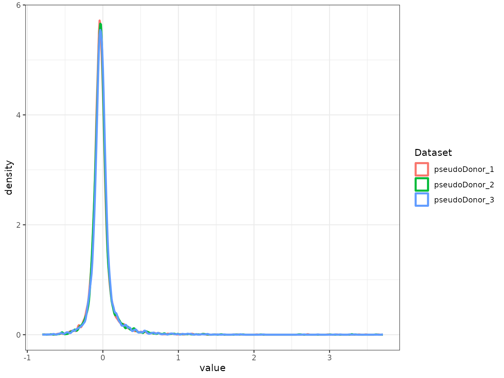
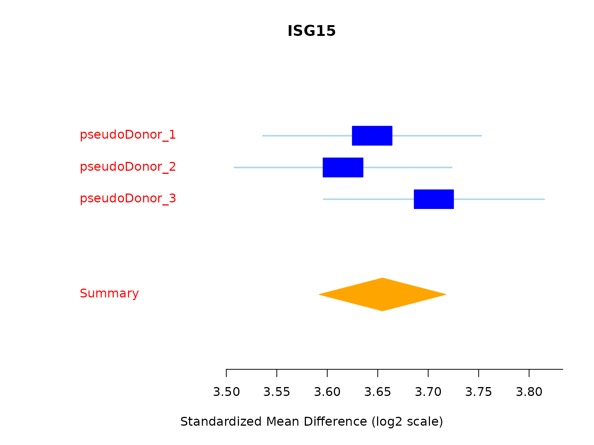
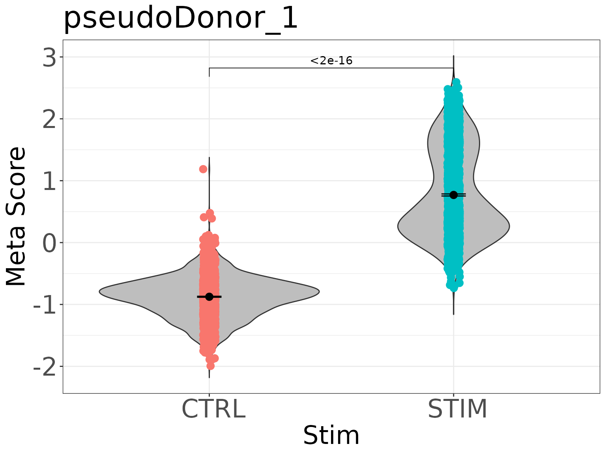
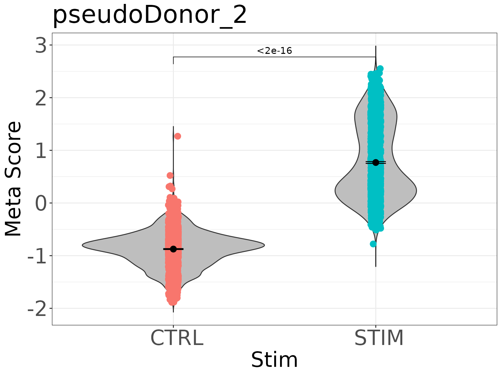
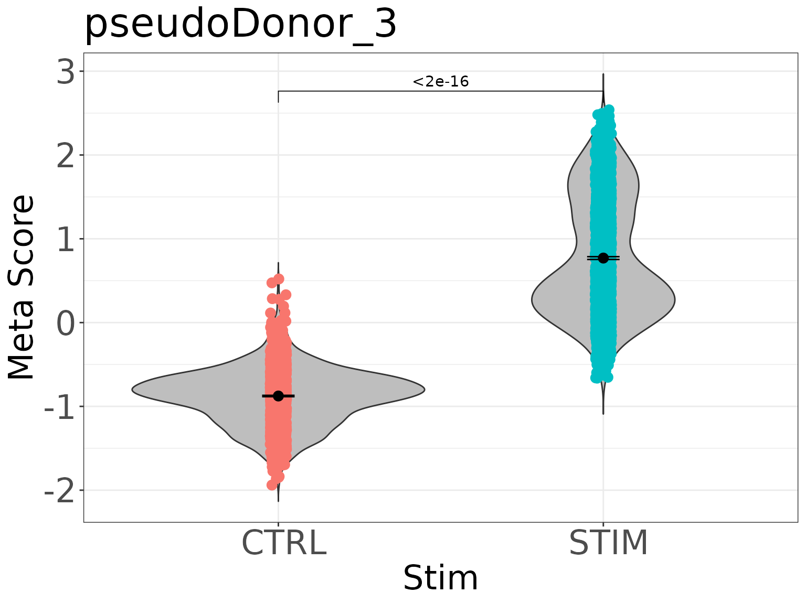
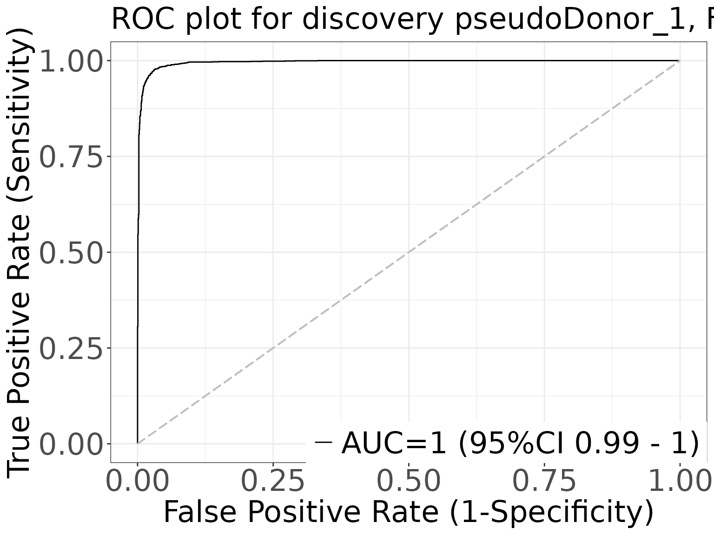
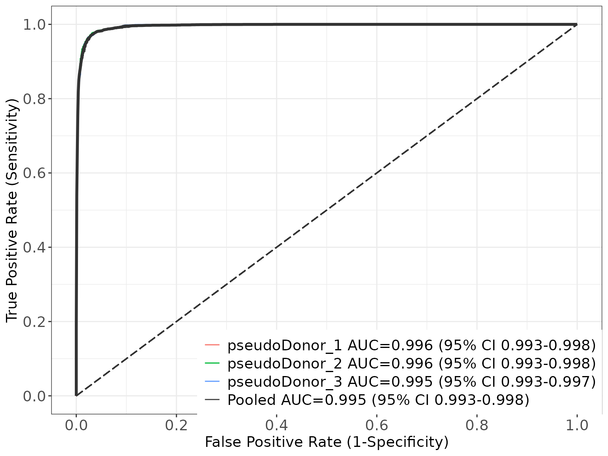

# Example 2: Full MetaIntegrator analysis with generateFullMA()

## Overview

Example 1 used
[`runscMI()`](https://khatri-lab.github.io/scMetaIntegrator/reference/runscMI.md)
to get a table of differentially expressed genes (DEGs). This example
uses
[`generateFullMA()`](https://khatri-lab.github.io/scMetaIntegrator/reference/generateFullMA.md),
which returns the full MetaIntegrator object. With the full object you
can run any MetaIntegrator function on your scMI results, such as forest
plots, gene signatures, gene scores and ROC curves.

The example also shows what to do when the pairing is incomplete. We
remove one sample on purpose, check the pairing, and keep only the
complete pairs.

| Step | Function | Purpose |
|:---|:---|:---|
| 1 to 2 | [`NormalizeData()`](https://satijalab.org/seurat/reference/NormalizeData.html) and metadata setup | Prepare four pseudo donors and remove one sample to create an unpaired donor |
| 3 to 4 | [`confirmPairs()`](https://khatri-lab.github.io/scMetaIntegrator/reference/confirmPairs.md), [`completePairSubset()`](https://khatri-lab.github.io/scMetaIntegrator/reference/completePairSubset.md) | Detect and remove incomplete pairs |
| 5 | [`thresholdGenesAcrossPairs()`](https://khatri-lab.github.io/scMetaIntegrator/reference/thresholdGenesAcrossPairs.md) | Keep genes expressed in at least 1% of cells in every pair |
| 6 | [`generateFullMA()`](https://khatri-lab.github.io/scMetaIntegrator/reference/generateFullMA.md) | Build the full MetaIntegrator object |
| 7 | `$metaAnalysis$pooledResults` | Get the detailed DE report |
| 8 | MetaIntegrator functions | Forest plot, gene signature, gene scores and ROC curves |

## Setup

The example data come from the `ifnb.SeuratData` package. See Example 1
for the install command. Loading MetaIntegrator is required to run
scMetaIntegrator.

``` r

library(scMetaIntegrator)
library(Seurat)
library(ifnb.SeuratData)
library(MetaIntegrator)
library(multtest)

## packages for the plots in step 5
library(ggplot2)
theme_set(theme_bw())
```

## Step 1: Load and preprocess the data

The `ifnb` dataset contains PBMCs that were stimulated with interferon
beta (`STIM`) or left as controls (`CTRL`). The dataset does not record
donors, so we assign each cell to one of four pseudo donors to have a
variable to pair on. In your own data, use the real donor or patient ID.

``` r

data("ifnb")
ifnb = UpdateSeuratObject(ifnb)
ifnb = NormalizeData(ifnb)

## assign cells to four pseudo donors in turn, then build a unique sample ID
ifnb$pseudoDonor = paste0("pseudoDonor_", rep(1:4, length.out = ncol(ifnb)))
ifnb$sample      = paste0(ifnb$pseudoDonor, "_", ifnb$stim)
```

## Step 2: Create an unpaired sample

We remove the stimulated sample of pseudo donor 4. This donor now has
only a control sample, to show how to handle imbalanced pairs.

``` r

ifnb = subset(ifnb, subset = sample != "pseudoDonor_4_STIM")
table(ifnb$pseudoDonor, ifnb$stim)
#>                
#>                 CTRL STIM
#>   pseudoDonor_1 1637 1863
#>   pseudoDonor_2 1637 1863
#>   pseudoDonor_3 1637 1863
#>   pseudoDonor_4 1637    0
```

## Step 3: Confirm the pairing structure

[`confirmPairs()`](https://khatri-lab.github.io/scMetaIntegrator/reference/confirmPairs.md)
returns `TRUE` only when every pair has exactly two samples. Here it
returns `FALSE` because pseudo donor 4 has one sample.

``` r

confirmPairs(ifnb, uniqueSampleID = "sample", pairingColumn = "pseudoDonor")
#> [1] FALSE
```

## Step 4: Remove unpaired samples

Because the pairing is incomplete, we keep only the complete pairs with
[`completePairSubset()`](https://khatri-lab.github.io/scMetaIntegrator/reference/completePairSubset.md).
You can also set `completePairsOnly = TRUE` in
[`generateFullMA()`](https://khatri-lab.github.io/scMetaIntegrator/reference/generateFullMA.md)
to do this inside the function. The table shows that pseudo donor 4 is
gone.

``` r

ifnb_complete = completePairSubset(ifnb, uniqueSampleID = "sample", pairingColumn = "pseudoDonor")
#> Removing the following samples: pseudoDonor_4
table(ifnb_complete$pseudoDonor, ifnb_complete$stim)
#>                
#>                 CTRL STIM
#>   pseudoDonor_1 1637 1863
#>   pseudoDonor_2 1637 1863
#>   pseudoDonor_3 1637 1863
```

## Step 5: Filter lowly expressed genes

[`thresholdGenesAcrossPairs()`](https://khatri-lab.github.io/scMetaIntegrator/reference/thresholdGenesAcrossPairs.md)
keeps genes detected in at least 1% of cells in every pair. Passing the
result to
[`generateFullMA()`](https://khatri-lab.github.io/scMetaIntegrator/reference/generateFullMA.md)
restricts the analysis to those genes.

``` r

thresholdedGenes = thresholdGenesAcrossPairs(
  seuratObject     = ifnb_complete,
  uniqueSampleID   = "sample",
  pairingColumn    = "pseudoDonor",
  percentThreshold = 0.01
)
length(thresholdedGenes)
#> [1] 6964
```

## Step 6: Run scMetaIntegrator and build the full object

[`generateFullMA()`](https://khatri-lab.github.io/scMetaIntegrator/reference/generateFullMA.md)
takes the same arguments as
[`runscMI()`](https://khatri-lab.github.io/scMetaIntegrator/reference/runscMI.md)
and returns the full MetaIntegrator `metaObject`. Two arguments matter
for this example:

- `runLeaveOneOut = TRUE` runs the leave-one-out analyses that
  [`filterGenes()`](https://rdrr.io/pkg/MetaIntegrator/man/filterGenes.html)
  needs in step 8.
- `maxCores = 1` limits the number of parallel processes.

The per-pair expression matrices are kept by default, which the forest
plot, gene scores and ROC plots need.

``` r

scMIObj = generateFullMA(
  seuratObject          = ifnb_complete,
  uniqueSampleID        = "sample",
  pairingColumn         = "pseudoDonor",
  comparisonGroupColumn = "stim",
  groupOne              = "STIM",
  groupTwo              = "CTRL",
  thresholdGenes        = thresholdedGenes,
  maxCores              = 1,
  runLeaveOneOut        = TRUE
)
#> Generating full MA object
#> Running meta-analysis
#> Found common probes in 2 
#> Found common probes in 3 
#> Computing effect sizes...
#> Computing summary effect sizes...
#> Computing Fisher's output...
```



    #> Found common probes in 2 
    #> Computing effect sizes...
    #> Computing summary effect sizes...
    #> Computing Fisher's output...Found common probes in 2 
    #> Computing effect sizes...
    #> Computing summary effect sizes...
    #> Computing Fisher's output...Found common probes in 2 
    #> Computing effect sizes...
    #> Computing summary effect sizes...
    #> Computing Fisher's output...

## Step 7: Get the detailed DE report

The pooled results table is stored in the object. It has the columns
returned by
[`runscMI()`](https://khatri-lab.github.io/scMetaIntegrator/reference/runscMI.md)
plus extra statistics, such as `tauSquared` for between-pair
heterogeneity.

``` r

scMI_output = scMIObj$metaAnalysis$pooledResults
head(scMI_output[order(scMI_output$effectSizeFDR), c("gene", "effectSize", "effectSizeFDR", "tauSquared", "numPairs")])
#>              gene effectSize effectSizeFDR  tauSquared numPairs
#> APOBEC3A APOBEC3A  0.9035652             0 0.000000000        3
#> BST2         BST2  1.0822657             0 0.000000000        3
#> CCL8         CCL8  0.9449267             0 0.000000000        3
#> CMPK2       CMPK2  1.1791856             0 0.001227172        3
#> CXCL10     CXCL10  1.3560547             0 0.000000000        3
#> CXCL11     CXCL11  1.0436900             0 0.000000000        3
```

## Step 8: Analyze the object with MetaIntegrator

All MetaIntegrator functions work on the object from step 6. The
[MetaIntegrator
vignette](http://cran.nexr.com/web/packages/MetaIntegrator/vignettes/MetaIntegrator.md)
lists the available methods.

### Step 8a: Forest plot of the top DEG

We pick the gene with the largest effect size among genes with an FDR of
0 and no heterogeneity between pairs. The forest plot shows the effect
size in each pseudo donor and the pooled estimate.

``` r

topDEG = scMI_output[scMI_output$effectSizeFDR == 0 & scMI_output$tauSquared == 0, ]
topDEG = topDEG[order(topDEG$effectSize, decreasing = TRUE), ]$gene[1]
forestPlot(scMIObj, topDEG)
#> [1] "character"
```



### Step 8b: Build a gene signature and score each cell

[`filterGenes()`](https://rdrr.io/pkg/MetaIntegrator/man/filterGenes.html)
selects genes with an FDR below 0.0001 that remain significant when any
single pair is left out. It stores the gene signature in
`$filterResults`, under a name that records the filter settings. We then
score each cell with the signature and save the score in the cell
metadata of each pseudo donor.

``` r

scMIObj = filterGenes(scMIObj, isLeaveOneOut = TRUE, FDRThresh = 0.0001)
names(scMIObj$filterResults)
#> [1] "FDR1e-04_es0_nStudies1_looaTRUE_hetero0"

gene_signature = scMIObj$filterResults[["FDR1e-04_es0_nStudies1_looaTRUE_hetero0"]]

for (donor in names(scMIObj$originalData)) {
  scMIObj$originalData[[donor]]$pheno$score =
    calculateScore(gene_signature, scMIObj$originalData[[donor]])
}
#> Used  533 of  533  pos genes, and  684  of  684  neg genes 
#> Used  533 of  533  pos genes, and  684  of  684  neg genes 
#> Used  533 of  533  pos genes, and  684  of  684  neg genes
```

### Step 8c: Violin plots of the signature score

``` r

violinPlot(gene_signature, scMIObj$originalData$pseudoDonor_1, labelColumn = "stim")
```



``` r

violinPlot(gene_signature, scMIObj$originalData$pseudoDonor_2, labelColumn = "stim")
```



``` r

violinPlot(gene_signature, scMIObj$originalData$pseudoDonor_3, labelColumn = "stim")
```



### Step 8d: ROC plot for one pseudo donor

``` r

rocPlot(gene_signature, scMIObj$originalData$pseudoDonor_1,
        title = "ROC plot for discovery pseudoDonor_1, FDR: 0.0001")
#> Used  533 of  533  pos genes, and  684  of  684  neg genes 
#> For dataset pseudoDonor_1, AUC = 0.996
```



### Step 8e: Pooled ROC across all pseudo donors

``` r

pooledROCPlot(scMIObj, gene_signature)
```


