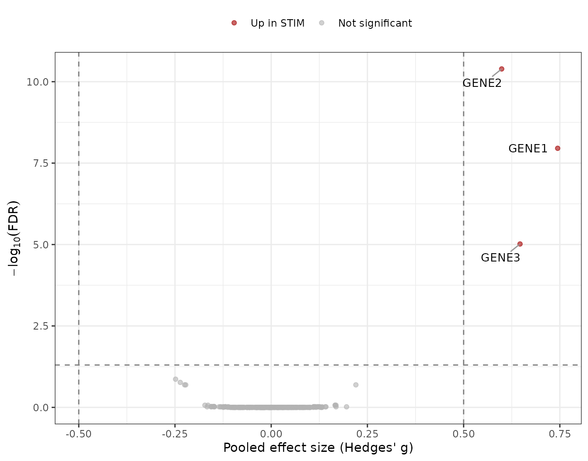
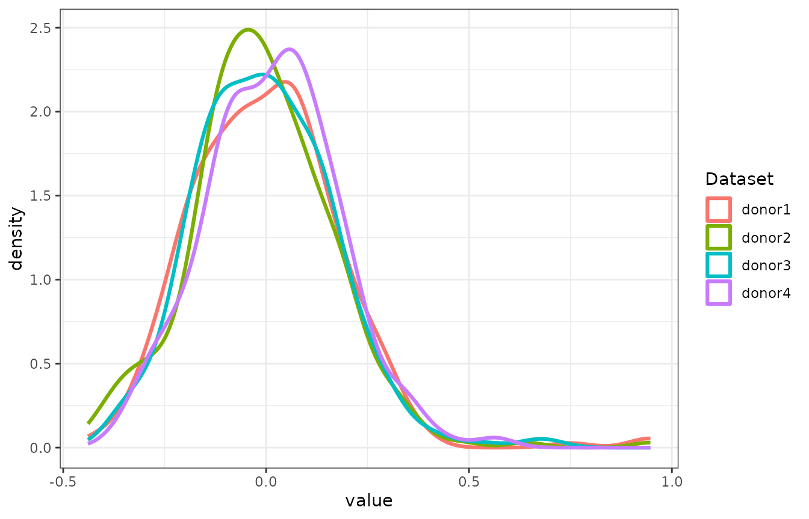
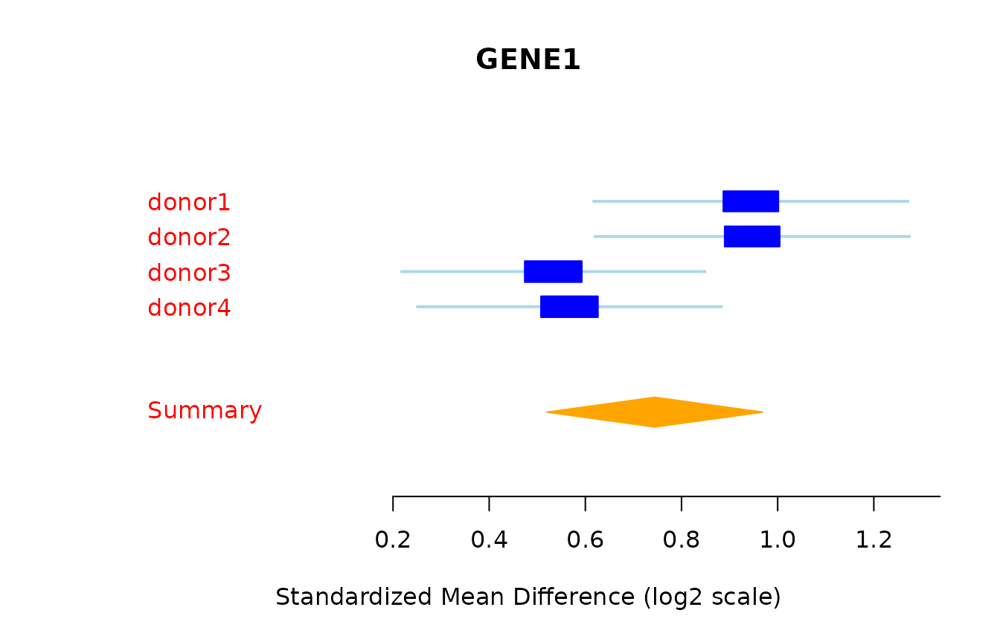

# Getting started with scMetaIntegrator

## Overview

scMetaIntegrator (scMI) tests for differential expression in paired
single-cell RNA-seq data. Each matched pair, such as one donor measured
under two conditions, is treated as one study. Within a pair, scMI
compares cells from the two conditions and computes a per-gene effect
size (Hedges’ g). It then pools the effect sizes across pairs with
random-effects meta-analysis using
[MetaIntegrator](https://CRAN.R-project.org/package=MetaIntegrator).

This article walks through a complete analysis on simulated data, from
checking the pairing to plotting the results. Loading the MetaIntegrator
package is required to run scMetaIntegrator.

| Step | Function | What it does |
|:---|:---|:---|
| Validate | [`confirmPairs()`](https://khatri-lab.github.io/scMetaIntegrator/reference/confirmPairs.md) | Checks that every pair has exactly two samples |
| Subset | [`completePairSubset()`](https://khatri-lab.github.io/scMetaIntegrator/reference/completePairSubset.md) | Keeps only complete pairs |
| Filter genes | [`thresholdGenesAcrossPairs()`](https://khatri-lab.github.io/scMetaIntegrator/reference/thresholdGenesAcrossPairs.md) | Keeps genes expressed in a minimum fraction of cells in every pair |
| Run (simple output) | [`runscMI()`](https://khatri-lab.github.io/scMetaIntegrator/reference/runscMI.md) | Returns one table of pooled results per gene |
| Run (full object) | [`generateFullMA()`](https://khatri-lab.github.io/scMetaIntegrator/reference/generateFullMA.md) | Returns a MetaIntegrator `metaObject` for forest plots, gene scores and leave-one-out filtering |

``` r

library(scMetaIntegrator)
library(Seurat)
library(MetaIntegrator)
library(ggplot2)
library(ggrepel)

theme_set(theme_bw())
```

## Data requirements

scMI needs a Seurat v5 object with log-normalized expression in the
`data` layer and three metadata columns.

| Metadata column | What it holds | Example in this article |
|:---|:---|:---|
| Unique sample ID | One value per sample | `sample` (`donor1_CTRL`) |
| Pairing variable | The value shared by the two samples in a pair | `donor` (`donor1`) |
| Comparison variable | The two conditions to compare | `condition` (`STIM`, `CTRL`) |

Every pair must contain exactly two samples, one per condition.

## 1. Simulate a paired scRNA-seq experiment

We simulate four donors, each sampled under a control and a stimulated
condition, with 80 cells per sample. Three genes (`GENE1` to `GENE3`)
are up-regulated in the stimulated condition.

``` r

set.seed(4)
n_genes   = 300
genes     = paste0("GENE", seq_len(n_genes))
donors    = paste0("donor", 1:4)
conds     = c("CTRL", "STIM")
n_cells   = 80
de_genes  = c("GENE1", "GENE2", "GENE3")
base_mean = rgamma(n_genes, shape = 1, rate = 1)
names(base_mean) = genes

counts_list = list()
meta_list   = list()
for (d in donors) {
  for (cnd in conds) {
    mu = base_mean
    if (cnd == "STIM") mu[de_genes] = mu[de_genes] * 3
    size_factor = rlnorm(n_cells, 0, 0.2)
    m = sapply(size_factor, function(sf) rnbinom(n_genes, mu = mu * sf, size = 2))
    sample_id = paste(d, cnd, sep = "_")
    cell_ids  = paste(sample_id, seq_len(n_cells), sep = "_")
    dimnames(m) = list(genes, cell_ids)
    counts_list[[sample_id]] = m
    meta_list[[sample_id]] = data.frame(sample    = rep(sample_id, n_cells),
                                        donor     = rep(d, n_cells),
                                        condition = rep(cnd, n_cells),
                                        row.names = cell_ids)
  }
}

seu = CreateSeuratObject(counts = do.call(cbind, counts_list),
                         meta.data = do.call(rbind, meta_list))
seu = NormalizeData(seu)
table(seu$donor, seu$condition)
#>         
#>          CTRL STIM
#>   donor1   80   80
#>   donor2   80   80
#>   donor3   80   80
#>   donor4   80   80
```

## 2. Check the pairing

``` r

confirmPairs(seu, uniqueSampleID = "sample", pairingColumn = "donor")
#> [1] TRUE
```

`TRUE` means every donor has exactly two samples. If it returns `FALSE`,
drop the incomplete pairs with
[`completePairSubset()`](https://khatri-lab.github.io/scMetaIntegrator/reference/completePairSubset.md),
or set `completePairsOnly = TRUE` in
[`runscMI()`](https://khatri-lab.github.io/scMetaIntegrator/reference/runscMI.md)
or
[`generateFullMA()`](https://khatri-lab.github.io/scMetaIntegrator/reference/generateFullMA.md).

``` r

seu = completePairSubset(seu, uniqueSampleID = "sample", pairingColumn = "donor")
```

## 3. Choose genes to test

[`thresholdGenesAcrossPairs()`](https://khatri-lab.github.io/scMetaIntegrator/reference/thresholdGenesAcrossPairs.md)
keeps genes detected in at least `percentThreshold` of cells in every
pair. Passing the result as `thresholdGenes` restricts the analysis to
those genes and reduces memory use.

``` r

thresholdedGenes = thresholdGenesAcrossPairs(
  seuratObject     = seu,
  uniqueSampleID   = "sample",
  pairingColumn    = "donor",
  percentThreshold = 0.01
)
length(thresholdedGenes)
#> [1] 293
```

## 4. Run scMI

`groupOne` is the condition whose effect you want to estimate.
`groupTwo` is the reference, usually the control. A positive effect size
means higher expression in `groupOne`.

``` r

scMI_output = runscMI(
  seuratObject          = seu,
  uniqueSampleID        = "sample",
  pairingColumn         = "donor",
  comparisonGroupColumn = "condition",
  groupOne              = "STIM",
  groupTwo              = "CTRL",
  thresholdGenes        = thresholdedGenes
)
#> Found common probes in 2 
#> Found common probes in 3 
#> Found common probes in 4 
#> Computing effect sizes...
#> Computing summary effect sizes...
#> Computing Fisher's output...
```


``` r

head(scMI_output[order(scMI_output$effectSizeFDR), ])
#>            gene effectSize effectSizeFDR effectSizePval effectSizeBF numPairs
#> GENE2     GENE2  0.5988097  4.059006e-11   1.385326e-13 4.059006e-11        4
#> GENE1     GENE1  0.7442910  1.109904e-08   7.576135e-11 2.219807e-08        4
#> GENE3     GENE3  0.6464974  9.617688e-06   9.847462e-08 2.885306e-05        4
#> GENE160 GENE160 -0.2484045  1.363979e-01   1.862087e-03 5.455916e-01        4
#> GENE118 GENE118 -0.2362868  1.709081e-01   2.916520e-03 8.545404e-01        4
#> GENE176 GENE176 -0.2248811  2.032818e-01   4.604003e-03 1.000000e+00        4
```

The columns are the pooled effect size (`effectSize`), its p-value and
FDR (`effectSizePval`, `effectSizeFDR`), a Bonferroni-adjusted p-value
(`effectSizeBF`), and the number of pairs that contributed (`numPairs`).

The three genes we up-regulated in the simulation should show positive
effect sizes.

``` r

scMI_output[scMI_output$gene %in% de_genes, ]
#>        gene effectSize effectSizeFDR effectSizePval effectSizeBF numPairs
#> GENE2 GENE2  0.5988097  4.059006e-11   1.385326e-13 4.059006e-11        4
#> GENE1 GENE1  0.7442910  1.109904e-08   7.576135e-11 2.219807e-08        4
#> GENE3 GENE3  0.6464974  9.617688e-06   9.847462e-08 2.885306e-05        4
```

### Count differentially expressed genes

``` r

table(Significant = scMI_output$effectSizeFDR < 0.05,
      Direction   = ifelse(scMI_output$effectSize > 0, "positive", "negative"))
#>            Direction
#> Significant negative positive
#>       FALSE      158      132
#>       TRUE         0        3
```

### Volcano plot

Genes with an FDR below 0.05 and an absolute effect size above 0.5 are
colored and labeled. FDR values of 0 are set to 1e-300 so they can be
plotted on a log scale.

``` r

volcano_df = scMI_output
volcano_df$neg_log10_fdr = -log10(pmax(volcano_df$effectSizeFDR, 1e-300))
volcano_df$category = ifelse(volcano_df$effectSizeFDR < 0.05 & volcano_df$effectSize >  0.5, "Up in STIM",
                      ifelse(volcano_df$effectSizeFDR < 0.05 & volcano_df$effectSize < -0.5, "Up in CTRL",
                             "Not significant"))
volcano_df$category = factor(volcano_df$category,
                             levels = c("Up in STIM", "Up in CTRL", "Not significant"))

label_df = volcano_df[volcano_df$category != "Not significant", ]

ggplot(volcano_df, aes(x = effectSize, y = neg_log10_fdr, color = category)) +
  geom_point(alpha = 0.6, size = 1.5) +
  geom_vline(xintercept = c(-0.5, 0.5), linetype = "dashed", color = "grey50") +
  geom_hline(yintercept = -log10(0.05), linetype = "dashed", color = "grey50") +
  geom_text_repel(data = label_df, aes(label = gene), color = "black", size = 3.5,
                  max.overlaps = Inf, box.padding = 0.5, segment.color = "grey60") +
  scale_color_manual(values = c("Up in STIM"      = "#A40000FF",
                                "Up in CTRL"      = "#16317DFF",
                                "Not significant" = "grey70")) +
  labs(x = "Pooled effect size (Hedges' g)",
       y = expression(-log[10](FDR)),
       color = NULL) +
  theme(legend.position = "top")
```



## 5. Get the full MetaIntegrator object

[`generateFullMA()`](https://khatri-lab.github.io/scMetaIntegrator/reference/generateFullMA.md)
returns the full MetaIntegrator object. The pooled table is in
`$metaAnalysis$pooledResults` and contains extra columns such as
`tauSquared` for between-pair heterogeneity. Here we set
`runLeaveOneOut = TRUE` because section 7 filters genes with
leave-one-out support, and `maxCores = 2` to limit the number of
parallel processes.

``` r

scMIObj = generateFullMA(
  seuratObject          = seu,
  uniqueSampleID        = "sample",
  pairingColumn         = "donor",
  comparisonGroupColumn = "condition",
  groupOne              = "STIM",
  groupTwo              = "CTRL",
  thresholdGenes        = thresholdedGenes,
  maxCores              = 2,
  runLeaveOneOut        = TRUE
)
#> Found common probes in 2 
#> Found common probes in 3 
#> Found common probes in 4 
#> Computing effect sizes...
#> Computing summary effect sizes...
#> Computing Fisher's output...
```



``` r

pooled_res = scMIObj$metaAnalysis$pooledResults
head(pooled_res[order(pooled_res$effectSizeFDR), c("gene", "effectSize", "effectSizeFDR", "tauSquared", "numPairs")])
#>            gene effectSize effectSizeFDR   tauSquared numPairs
#> GENE2     GENE2  0.5988097  4.059006e-11 0.0000000000        4
#> GENE1     GENE1  0.7442910  1.109904e-08 0.0254047279        4
#> GENE3     GENE3  0.6464974  9.617688e-06 0.0323788268        4
#> GENE160 GENE160 -0.2484045  1.363979e-01 0.0002369078        4
#> GENE118 GENE118 -0.2362868  1.709081e-01 0.0000000000        4
#> GENE176 GENE176 -0.2248811  2.032818e-01 0.0000000000        4
#> fect sizes...
#> Computing Fisher's output...
```

### Forest plot for one gene

A forest plot shows the per-pair effect sizes and the pooled estimate.

``` r

forestPlot(scMIObj, "GENE1")
#> [1] "character"
```



## 6. Memory and speed options

Both functions share three arguments that control memory use.

| Argument | Default in [`generateFullMA()`](https://khatri-lab.github.io/scMetaIntegrator/reference/generateFullMA.md) | Default in [`runscMI()`](https://khatri-lab.github.io/scMetaIntegrator/reference/runscMI.md) | Effect |
|:---|:---|:---|:---|
| `runLeaveOneOut` | `FALSE` | `FALSE` | Runs k extra meta-analyses, each leaving out one pair. Required by `MetaIntegrator::filterGenes(isLeaveOneOut = TRUE)`. Pooled results are identical either way |
| `keepExpr` | `TRUE` | `FALSE` | Keeps the per-pair expression matrices in the returned object. Required for [`forestPlot()`](https://rdrr.io/pkg/MetaIntegrator/man/forestPlot.html), [`calculateScore()`](https://rdrr.io/pkg/MetaIntegrator/man/calculateScore.html) and [`pooledROCPlot()`](https://rdrr.io/pkg/MetaIntegrator/man/pooledROCPlot.html) |
| `maxCores` | `NULL` | `NULL` | Number of cores passed to [`MetaIntegrator::runMetaAnalysis()`](https://rdrr.io/pkg/MetaIntegrator/man/runMetaAnalysis.html) |

For large objects, filter genes with `thresholdGenes`, and use
[`runscMI()`](https://khatri-lab.github.io/scMetaIntegrator/reference/runscMI.md)
when only the pooled table is needed.

## 7. Filter genes with leave-one-out support

When the full object was built with `runLeaveOneOut = TRUE` (as in
section 5), MetaIntegrator can filter to genes whose significance holds
when any single pair is removed.

``` r

scMIObj = filterGenes(scMIObj, isLeaveOneOut = TRUE, FDRThresh = 0.05)
names(scMIObj$filterResults)
#> [1] "FDR0.05_es0_nStudies1_looaTRUE_hetero0"
```

## Next steps

The Example 1 and Example 2 articles apply scMI to real paired data and
show gene scores, ROC plots and other MetaIntegrator analyses on the
full object. The function reference documents every argument.

The format of this article follows the expresso package’s [getting
started
article](https://zhengh42.github.io/expresso/articles/expresso.html).

## Session info

``` r

sessionInfo()
#> R version 4.6.1 (2026-06-24)
#> Platform: x86_64-pc-linux-gnu
#> Running under: Ubuntu 24.04.5 LTS
#> 
#> Matrix products: default
#> BLAS:   /usr/lib/x86_64-linux-gnu/openblas-pthread/libblas.so.3 
#> LAPACK: /usr/lib/x86_64-linux-gnu/openblas-pthread/libopenblasp-r0.3.26.so;  LAPACK version 3.12.0
#> 
#> locale:
#>  [1] LC_CTYPE=C.UTF-8       LC_NUMERIC=C           LC_TIME=C.UTF-8       
#>  [4] LC_COLLATE=C.UTF-8     LC_MONETARY=C.UTF-8    LC_MESSAGES=C.UTF-8   
#>  [7] LC_PAPER=C.UTF-8       LC_NAME=C              LC_ADDRESS=C          
#> [10] LC_TELEPHONE=C         LC_MEASUREMENT=C.UTF-8 LC_IDENTIFICATION=C   
#> 
#> time zone: UTC
#> tzcode source: system (glibc)
#> 
#> attached base packages:
#> [1] stats     graphics  grDevices utils     datasets  methods   base     
#> 
#> other attached packages:
#> [1] ggrepel_0.9.8          ggplot2_4.0.3          MetaIntegrator_2.1.3  
#> [4] Seurat_5.6.0           SeuratObject_5.4.0     sp_2.2-4              
#> [7] scMetaIntegrator_1.0.1
#> 
#> loaded via a namespace (and not attached):
#>   [1] RColorBrewer_1.1-3     jsonlite_2.0.0         magrittr_2.0.5        
#>   [4] spatstat.utils_3.2-5   farver_2.1.2           rmarkdown_2.32        
#>   [7] fs_2.1.0               ragg_1.5.2             vctrs_0.7.3           
#>  [10] multtest_2.68.0        ROCR_1.0-12            spatstat.explore_3.8-3
#>  [13] rstatix_1.1.0          htmltools_0.5.9        broom_1.0.13          
#>  [16] Formula_1.2-6          sass_0.4.10            sctransform_0.4.3     
#>  [19] parallelly_1.48.0      KernSmooth_2.23-26     bslib_0.12.0          
#>  [22] htmlwidgets_1.6.4      desc_1.4.3             ica_1.0-3             
#>  [25] plyr_1.8.9             plotly_4.12.1          zoo_1.9-1             
#>  [28] cachem_1.1.0           igraph_2.3.4           mime_0.13             
#>  [31] lifecycle_1.0.5        pkgconfig_2.0.3        Matrix_1.7-5          
#>  [34] R6_2.6.1               fastmap_1.2.0          fitdistrplus_1.2-6    
#>  [37] future_1.80.0          shiny_1.14.0           digest_0.6.39         
#>  [40] patchwork_1.3.2        tensor_1.5.1           RSpectra_0.16-2       
#>  [43] irlba_2.4.1            textshaping_1.0.5      ggpubr_1.0.0          
#>  [46] labeling_0.4.3         progressr_1.1.0        spatstat.sparse_3.2-0 
#>  [49] httr_1.4.9             polyclip_1.10-7        abind_1.4-8           
#>  [52] compiler_4.6.1         withr_3.0.3            S7_0.2.2              
#>  [55] backports_1.5.1        carData_3.0-6          fastDummies_1.7.6     
#>  [58] ggsignif_0.6.4         MASS_7.3-65            tools_4.6.1           
#>  [61] lmtest_0.9-40          otel_0.2.0             httpuv_1.6.17         
#>  [64] future.apply_1.21.0    goftest_1.2-3          glue_1.8.1            
#>  [67] nlme_3.1-169           promises_1.5.0         grid_4.6.1            
#>  [70] Rtsne_0.17             cluster_2.1.8.2        reshape2_1.4.5        
#>  [73] generics_0.1.4         gtable_0.3.6           spatstat.data_3.1-9   
#>  [76] tidyr_1.3.2            data.table_1.18.6.1    car_3.1-5             
#>  [79] BiocGenerics_0.58.1    spatstat.geom_3.8-3    RcppAnnoy_0.0.23      
#>  [82] RANN_2.6.3             pillar_1.11.1          stringr_1.6.0         
#>  [85] spam_2.11-4            RcppHNSW_0.7.0         later_1.4.8           
#>  [88] splines_4.6.1          dplyr_1.2.1            lattice_0.22-9        
#>  [91] survival_3.8-6         deldir_2.0-4           tidyselect_1.2.1      
#>  [94] miniUI_0.1.2           pbapply_1.7-5          knitr_1.52            
#>  [97] gridExtra_2.3.1        scattermore_1.2        stats4_4.6.1          
#> [100] xfun_0.62              Biobase_2.72.0         matrixStats_1.5.0     
#> [103] stringi_1.8.9          yaml_2.3.12            evaluate_1.0.5        
#> [106] codetools_0.2-20       tibble_3.3.1           cli_3.6.6             
#> [109] uwot_0.2.5             xtable_1.8-8           reticulate_1.47.0     
#> [112] systemfonts_1.3.2      jquerylib_0.1.4        Rcpp_1.1.2            
#> [115] rmeta_3.0              globals_0.20.0         spatstat.random_3.5-2 
#> [118] png_0.1-9              spatstat.univar_3.2-0  parallel_4.6.1        
#> [121] pkgdown_2.2.1          dotCall64_1.2          listenv_1.1.0         
#> [124] viridisLite_0.4.3      scales_1.4.0           ggridges_0.5.7        
#> [127] purrr_1.2.2            rlang_1.3.0            cowplot_1.2.0
```
